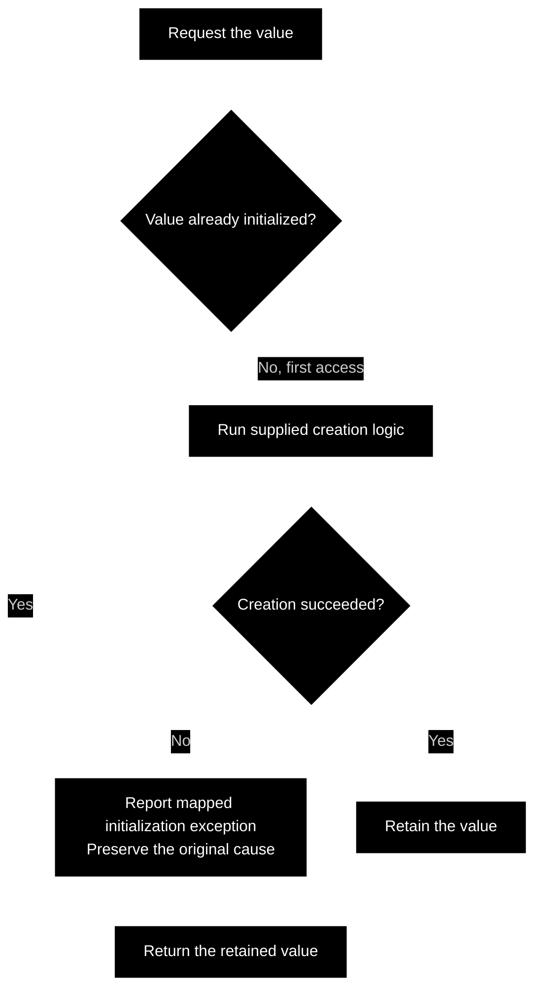
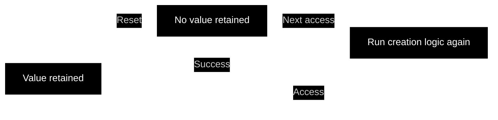

CAE Concept

---

 

### Clean Initializers

This concept defines how a value is created on first access, retained, and reused by its consumers.

The current scope is **lazy initialization**: the caller supplies creation logic, and the initializer defers running it until the value is first requested. Once creation succeeds, later accesses reuse the retained value.

 

#### Standalone Use

The lazy initializer can be imported and used directly from application code. It does not require an application framework, a dependency injection container, or a framework-managed lifecycle.

The caller supplies creation logic as a callable, such as a lambda or a reference to an existing function or method, and accesses the managed value through the initializer's APIs. No initializer subclass is required to provide that behavior.

The same approach works in a script, a command-line tool, or a framework-based application. The caller controls where the initializer is created and shared, defining which consumers reuse its retained value.

 

#### Creation and Access

Creation logic describes **how to construct a value**. Access requests **the value managed by the initializer**.

A lazy initializer defers creation until the first access. For example, an integration client can be declared during assembly and constructed when a workflow first needs it.

Declaring the initializer does not construct the value. Creation costs and failures become visible when the value is first requested.

 

#### Retention

Successful initialization stores the created value. Later accesses return that retained value until it is invalidated.

Reuse is scoped to the initializer instance. Separate initializers retain their values independently, even when supplied with the same creation logic.

An empty value, if allowed, must be distinguishable from the uninitialized state.

 

#### Failure

A failed creation attempt produces a mapped initialization exception preserving the original cause.

Failure leaves no successfully initialized value. The initializer's contract must define whether a later access retries creation or reports the retained failure.

Retrying creation is a separate decision from reusing a successfully created value.

 

#### Concurrent Access

An initializer supporting concurrent access coordinates creation and publication of its value.

Concurrent callers should obtain the same retained result after successful initialization. The concurrency contract must also define how access interacts with failure and reset.

 

#### Reset and Resource Ownership

Reset invalidates the retained value. A later access can run the creation logic again and retain its result.

Disposal releases resources held by a value. Reset and disposal have separate effects: invalidating the initializer's reference does not close a connection or revoke references already held by callers.

Resource ownership determines who disposes of the old value and when doing so is appropriate.

Reset changes what the initializer retains. It does not dispose of the previous value or invalidate references already held by consumers.

 
 

---

clean software, made easy.

